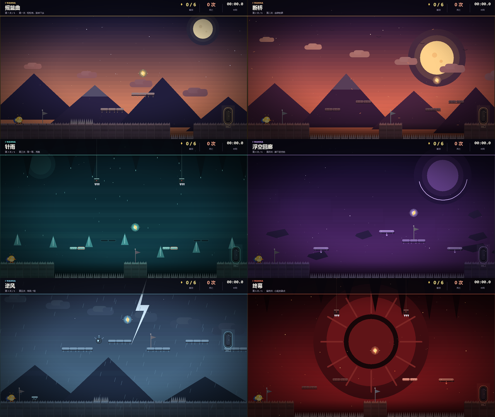

# I WANNA：啾比大冒险

> C++ 课程设计 · Win32 / GDI 手写 2D 平台跳跃游戏  
> 无第三方库、无外部图片/音频素材，所有画面与音效均由代码生成。


## 简介

一只不会飞的小黄鸟「啾比」，要穿过六间充满尖刺、断桥、移动平台和弹跳板的高塔。
游戏采用 I WANNA 式的一击即死、快速复活、检查点重开机制，但整体难度做了大幅简化：
**能玩、能通关，也保留一点“再来一次”的乐趣。**

- 6 个单屏关卡，每关有独立主题、配色和机关
- 二段跳、可变跳高、土狼时间、跳跃缓冲
- 尖刺 / 坠落 / 飞镖 / 落刺 / 碎裂平台 / 定时平台 / 移动平台 / 弹跳板
- 6 根隐藏「星羽」收集，通关评价 S～D
- 自动存档、继续游戏、最佳纪录
- 原创圆滚滚小黄鸟与手绘 GDI 背景，无版权素材



## 操作

| 按键 | 功能 |
| --- | --- |
| `A` / `D` 或 `←` / `→` | 左右移动 |
| `Space` / `W` / `↑` / `K` | 跳跃；空中再按一次二段跳 |
| `R` | 重新开始本关 |
| `Esc` | 暂停 / 返回 |
| `Enter` | 菜单确认 |
| 鼠标 | 标题/暂停菜单：移动选择、点击确认 |
| `M` | 静音 |
| `F11` | 全屏 / 返回窗口（保持 16:9，不拉伸变形） |
| `F12` | 保存 BMP 截图到 `shots\` |
| `F3` | 调试信息（开发用） |

跳跃手感：短按小跳，长按跳得更高；离开平台后约 0.1 秒内仍可起跳（土狼时间），
落地前约 0.12 秒内按跳会被缓存（跳跃缓冲）。

## 直接运行

双击项目根目录的 **`JubiIWanna.exe`** 即可。  
系统要求：Windows 10 / 11 x64；无需安装运行库，已使用 `/MT` 静态链接。

存档文件位于 exe 同目录：

- `jubi_save.txt`：当前进度（关卡、死亡数、时间、星羽、检查点）
- `record.dat`：最佳通关纪录

删除这两个文件即可重置进度。

## 编译

### 方法一：一键脚本（推荐）

双击 **`build.bat`**，或在命令行执行：

```bat
build.bat
```

脚本会自动寻找 Visual Studio 的 `vcvars64.bat`，使用 MSVC 编译并生成
`JubiIWanna.exe`。需要安装 Visual Studio 的「使用 C++ 的桌面开发」工作负载。

### 方法二：CMake

```bat
cmake -S . -B build-cmake -A x64
cmake --build build-cmake --config Release
```

生成的可执行文件位于 `build-cmake\Release\JubiIWanna.exe`。

### 方法三：Visual Studio

新建“Windows 桌面应用程序”项目，把 `src` 下所有 `.cpp/.h` 加入项目：

- C++ 语言标准：`ISO C++17`
- 字符集：`Unicode`
- 运行库：`多线程 (/MT)`（Release）
- 子系统：`Windows (/SUBSYSTEM:WINDOWS)`
- 链接库：`user32.lib;gdi32.lib;winmm.lib;msimg32.lib;shell32.lib`

## 项目结构

```text
JubiIWanna/
├─ src/
│  ├─ Common.h       基础类型、数学工具、输入状态
│  ├─ Renderer.h/.cpp GDI 双缓冲渲染、字体、透明、晕影、BMP 截图
│  ├─ Audio.h/.cpp   程序化 8-bit 音效（PlaySound + 内存 WAV）
│  ├─ Level.h/.cpp   6 关地图、瓦片、机关、碰撞、背景绘制
│  ├─ Player.h/.cpp  啾比的移动、跳跃、碰撞与绘制
│  ├─ Game.h/.cpp    标题/游戏/暂停/死亡/胜利流程、HUD、存档
│  └─ main.cpp       Win32 窗口、消息循环、固定步长、CLI 截图
├─ docs/
│  ├─ screenshots/   游戏截图
│  └─ 设计报告.md    课程设计报告
├─ .github/workflows/ Windows CI：CMake 构建并上传 exe
├─ build.bat         一键编译
├─ CMakeLists.txt    CMake 工程
├─ app.manifest      Per-Monitor V2 DPI 清单
├─ JubiIWanna.exe    已编译的 64 位可执行文件
├─ 设计报告.docx     课程设计报告（Word）
├─ CONTRIBUTING.md   分支、提交与构建约定
└─ README.md
```

## 技术要点

- **纯 Win32 + GDI**：不依赖 SFML/SDL/EasyX，1280×720 逻辑画布，
  32 位 DIB 双缓冲；窗口固定 1280×720，`F11` 进入真正的无边框全屏并按 16:9 等比缩放，避免高 DPI 下窗口被拉大导致黑屏。
- **固定时间步长**：物理以 1/120 秒更新，渲染约 60 FPS，
  避免不同机器上跳跃高度不一致。
- **分轴 AABB 碰撞**：先水平后垂直，逐轴解决；单向平台只在“下落且脚底
  不低于平台顶面”时落地，可从下方穿过。
- **手感参数**：土狼时间 0.1s、跳跃缓冲 0.12s、松开跳跃键将上升速度
  乘以 0.45，形成可变跳高。
- **程序化音效**：启动时用正弦/方波/噪声合成 16 位单声道 WAV，
  通过 `PlaySound(..., SND_MEMORY | SND_ASYNC)` 播放，不读取音频文件。
- **自动存档**：进入关卡、激活检查点、拾取星羽时写入文本存档；
  死亡后回到最近检查点，星羽与死亡数保留。

## 关卡一览

| 关卡 | 主题 | 主要机关 |
| --- | --- | --- |
| 第一关 · 摇篮曲 | 暮色山谷 | 尖刺、台阶、二段跳教学 |
| 第二关 · 断桥 | 落日断桥 | 碎裂平台、长尖刺沟 |
| 第三关 · 针雨 | 青绿洞窟 | 定时平台、落刺 |
| 第四关 · 浮空回廊 | 紫色虚空 | 水平/垂直移动平台 |
| 第五关 · 逆风 | 暴雨山脊 | 弹跳板、无人机飞镖、闪电 |
| 第六关 · 终幕 | 赤红心脏 | 综合机关、最终冲刺 |

## 开发/测试命令

程序内置了一个隐藏的自动测试与截图模式，方便验证手感和生成文档配图：

```bat
JubiIWanna.exe --shot shots\room0.bmp --room 0 --state game
JubiIWanna.exe --shot shots\title.bmp --state title
JubiIWanna.exe --shot shots\paused.bmp --room 2 --state paused
JubiIWanna.exe --test jump --room 0 --out shots\test_jump.bmp
```

可用状态：`title`、`controls`、`game`、`paused`、`victory`。  
可用测试：`run`、`jump`、`double`、`bounce`、`gap`、`door`。

## 参与开发

本项目按 GitHub 协作方式组织，组员可以直接 fork / 建分支 / 提 Pull Request。

```bat
git clone https://github.com/Firefly26710773/JubilWanna.git
cd JubilWanna
build.bat
```

- 分支命名：`feat/xxx`、`fix/xxx`、`docs/xxx`
- 合并前请确认 `build.bat` 或 GitHub Actions 的 Windows 构建通过
- 详细约定见 [CONTRIBUTING.md](CONTRIBUTING.md)
- 修改头文件成员后请完整重编，避免只替换部分 `.obj` 造成 ABI 不一致
- 不提交 `build/`、`*.obj`、测试截图、存档和打包 zip

## 开源协议

代码与原创素材以 [MIT License](LICENSE) 发布。  
I WANNA 玩法与相关二创仅作为灵感参考，本仓库不包含任何原作素材。

## 素材与致谢

- 角色、背景、瓦片、UI、粒子全部由 GDI 图元绘制，音效由代码合成。
- 玩法灵感来自 I WANNA 系列与 B 站「鸣潮菲比啾比 I WANNA」相关二创；
  本作未使用任何原作图片、音频或角色素材。
- 字体使用系统自带的 Microsoft YaHei UI / Arial Black / Consolas。

---

如果只想快速体验：双击 `JubiIWanna.exe` → 开始游戏 → 一路向右。
