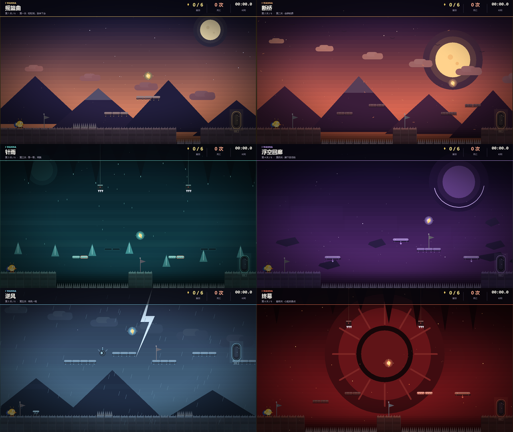
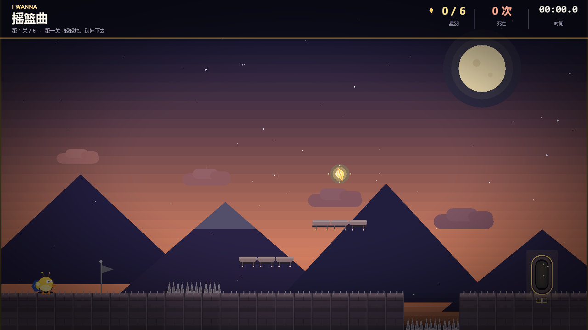
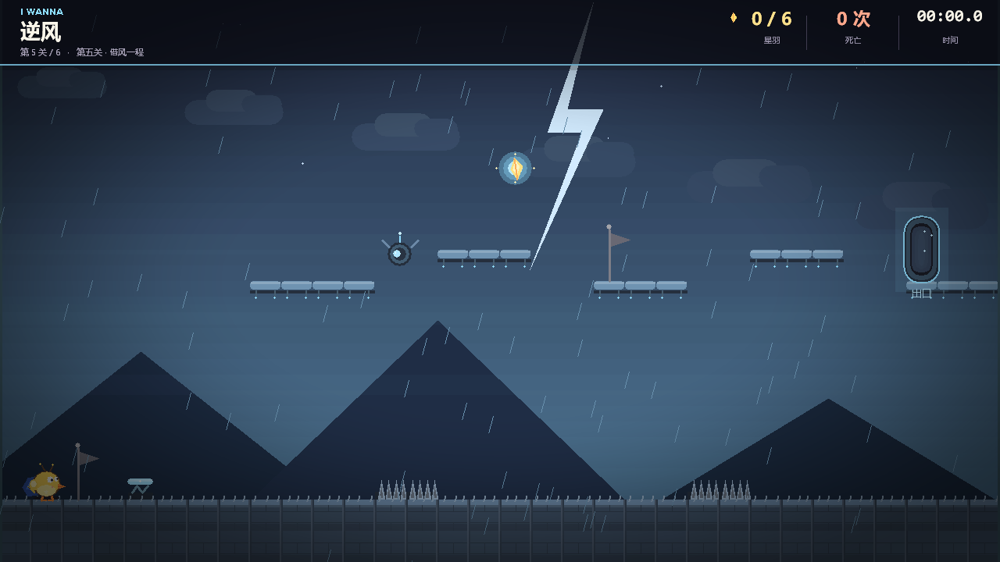
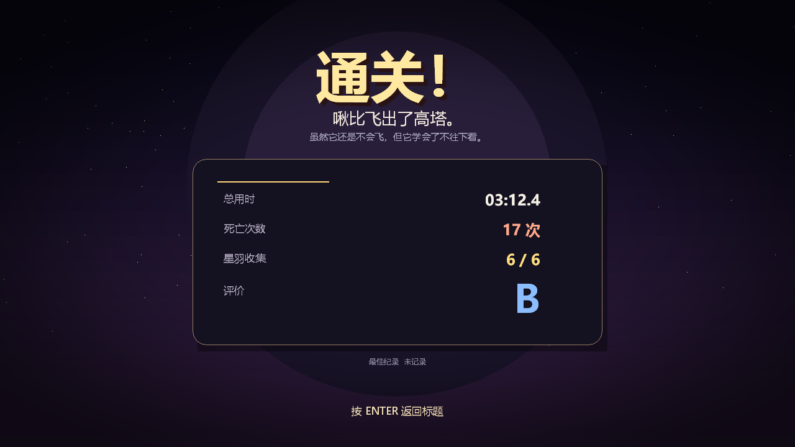

# C++ 课程设计报告

## I WANNA：啾比大冒险

**课程名称：** C++ 程序设计  
**姓名：** ____________________  
**学号：** ____________________  
**班级：** ____________________  
**完成日期：** 2026 年 11 月

---

## 摘要

本作品是一款使用 C++17 与 Win32/GDI 从零实现的 2D 横版闯关游戏《I WANNA：啾比大冒险》。玩家控制一只不会飞的小黄鸟「啾比」，在六个单屏关卡中躲避尖刺、跨越断桥、利用弹跳板与移动平台抵达出口。游戏参考 I WANNA 系列“一击即死、快速重开、检查点复活”的核心体验，但大幅降低了难度，并加入二段跳、可变跳高、土狼时间、跳跃缓冲等现代平台游戏手感设计。

程序不依赖任何第三方图形、音频或物理库，所有画面由 GDI 图元绘制，所有音效由代码合成；使用固定时间步长保证物理稳定，使用分轴 AABB 与单向平台碰撞实现可靠操作，使用文本存档保存进度与纪录。最终生成一个约 490 KB、可在 Windows 10/11 x64 上直接运行的单文件 exe。

**关键词：** C++；Win32；GDI；平台跳跃；I WANNA；游戏循环；AABB 碰撞

---

## 1. 选题背景与目标

### 1.1 选题背景

I WANNA 系列以高难度、即死陷阱和“背板”式关卡闻名。B 站上以《鸣潮》角色“菲比”为主角的二创 I WANNA 视频，把可爱的角色与毫不留情的机关放在一起，形成了强烈的反差趣味。课程设计希望做一个“看起来可爱、玩起来紧张，但确实能通关”的小型平台游戏，而不是单纯堆叠陷阱。

### 1.2 设计目标

1. **能玩**：完整跑通“标题—六关—胜利—重开”的流程，不出现死机、卡关。
2. **好操作**：跳跃高度可控，有土狼时间与跳跃缓冲，避免“明明按了却没跳”。
3. **有辨识度**：原创小黄鸟角色、六套主题配色、手绘感 GDI 背景。
4. **工程完整**：多文件组织、可一键编译、有存档、有说明文档。
5. **零依赖**：不要求安装 SFML/SDL/EasyX，机房或普通 Windows 电脑都能运行。

### 1.3 开发环境

| 项目 | 配置 |
| --- | --- |
| 操作系统 | Windows 11 x64 |
| 编译器 | MSVC 19.51（Visual Studio 2026 Insiders） |
| 语言标准 | C++17 |
| 图形接口 | Win32 + GDI |
| 音频接口 | winmm `PlaySound` |
| 构建方式 | `build.bat` / CMake / Visual Studio |
| 运行库 | `/MT` 静态链接 |

---

## 2. 需求分析

### 2.1 功能需求

- 标题菜单：开始游戏、继续游戏、操作说明、退出。
- 六个关卡：每关一张 32×18 的瓦片地图，独立主题与机关组合。
- 玩家操作：左右移动、跳跃、二段跳、可变跳高。
- 机关：尖刺、碎裂平台、定时平台、水平/垂直移动平台、弹跳板、落刺、无人机飞镖、检查点、出口门。
- 死亡与复活：一击即死，短暂死亡动画后回到最近检查点。
- 收集：每关一根星羽，共 6 根；死亡不丢失。
- 存档：保存关卡、死亡数、用时、星羽、检查点；标题界面可继续。
- 纪录：保存最佳通关时间与死亡数。
- 显示：HUD、房间标题横幅、暂停菜单、胜利结算、S～D 评价。
- 音频：跳跃、落地、死亡、检查点、收集、弹跳、碎裂、射击、胜利等程序化音效。
- 其他：全屏、静音、截图、失焦自动暂停。

### 2.2 非功能需求

- **性能**：1280×720 下稳定 60 FPS；物理固定 120 Hz。
- **兼容性**：Windows 10/11 x64，无需额外运行库。
- **可维护性**：渲染、音频、关卡、玩家、流程分模块，头文件接口清晰。
- **可移植性**：只依赖 Win32 API，不依赖特定 IDE。
- **无版权风险**：不使用任何原作图片、音频、字体文件或角色素材。

---

## 3. 总体设计

### 3.1 模块划分

| 模块 | 文件 | 职责 |
| --- | --- | --- |
| 公共基础 | `Common.h` | 常量、向量/矩形、颜色、数学工具、输入状态 |
| 渲染 | `Renderer.h/.cpp` | DIB 双缓冲、图元、字体、透明、晕影、BMP 截图 |
| 音频 | `Audio.h/.cpp` | 合成 WAV、音效枚举、静音 |
| 关卡 | `Level.h/.cpp` | 地图数据、瓦片、机关更新、碰撞、背景/前景绘制 |
| 玩家 | `Player.h/.cpp` | 移动、跳跃、碰撞响应、角色绘制 |
| 游戏流程 | `Game.h/.cpp` | 标题/控制/游戏/暂停/死亡/胜利、HUD、存档、粒子 |
| 程序入口 | `main.cpp` | 窗口、消息循环、固定步长、输入、CLI 截图/测试 |

### 3.2 程序结构

```text
WinMain
  ├─ 注册窗口 / 创建 1280×720 窗口
  ├─ Game::init(hwnd)
  │    ├─ Renderer::init  (DIB + 字体缓存)
  │    ├─ Audio::init     (合成音效)
  │    └─ 读取存档 / 纪录
  └─ 消息循环
       ├─ PeekMessage / 输入锁存
       ├─ 固定 1/120 步长更新 Game::update
       ├─ 约 60 FPS 渲染 Game::render
       └─ Game::present -> StretchBlt 到窗口
```

`Game` 持有 `Renderer`、`Audio`、`Level`、`Player` 四个对象；`Level` 不依赖 `Game`，`Player` 只通过 `Level` 的碰撞接口移动，模块之间保持单向依赖，便于单独测试。

### 3.3 游戏状态机

```text
Title ──开始/继续──> Playing ──Esc──> Paused
  ^                    │  │             │
  │                    │  └──死亡──> Dying ──复活──> Playing
  │                    │                │
  │                    └──到达出口──> Playing(下一关) / Victory
  └──────────────────── 返回标题 ───────┘
```

状态机集中在 `Game::update` 与 `Game::render` 的 `switch` 中；`Dying` 状态只推进计时器和粒子，不响应移动输入，避免死亡瞬间“拖尸”。

---

## 4. 关键技术实现

### 4.1 Win32 窗口与 GDI 双缓冲

窗口客户区固定为 1280×720 逻辑分辨率。渲染目标是一个 32 位顶朝下的 DIB Section：

```cpp
BITMAPINFO bmi{};
bmi.bmiHeader.biSize = sizeof(BITMAPINFOHEADER);
bmi.bmiHeader.biWidth = kScreenW;
bmi.bmiHeader.biHeight = -kScreenH;   // top-down
bmi.bmiHeader.biPlanes = 1;
bmi.bmiHeader.biBitCount = 32;
bmi.bmiHeader.biCompression = BI_RGB;
bitmap_ = CreateDIBSection(dc, &bmi, DIB_RGB_COLORS, &bits_, nullptr, 0);
```

所有绘制先画到内存 DC，最后根据窗口大小做等比例 `StretchBlt`，因此窗口缩放、最大化、F11 全屏都不会拉伸变形，也不会闪烁。`WM_ERASEBKGND` 直接返回 1，配合双缓冲消除擦除闪烁。

### 4.2 固定时间步长

如果直接用每帧 `deltaTime` 更新物理，不同刷新率下跳跃高度会漂移。`main.cpp` 使用累加器：

```cpp
const double kFixed = 1.0 / 120.0;
accumulator += frameTime;
int steps = 0;
while (accumulator >= kFixed && steps < 12) {
    game.update(static_cast<float>(kFixed), input);
    accumulator -= kFixed;
    ++steps;
}
```

物理固定 120 Hz，渲染约 60 FPS；最多补 12 步，防止电脑卡顿后“追帧”导致角色瞬移。输入在每帧只锁存一次按下边沿，由第一次物理步消费，避免 120 Hz 下重复触发二段跳。

### 4.3 分轴 AABB 碰撞与单向平台

玩家碰撞盒为 26×38。移动时先水平后垂直，分别解决：

```cpp
player.moveX(level, dx);   // 水平：撞墙停下
player.moveY(level, dy);   // 垂直：落地/顶头
```

水平移动时，把玩家矩形按 x 方向切成若干瓦片列，遇到实心瓦片就把玩家推到瓦片边缘；垂直移动同理。分轴处理可以避免“斜向卡角”，也让贴墙跳、平台边缘起跳更稳定。

单向平台（`=`、碎裂、定时、移动平台、弹跳板）只在满足以下条件时落地：

```cpp
// 只在下落，且移动前的脚底不低于平台顶面时才算落地
if (vel.y >= 0 && prevBottom <= top + 4.5f && box.bottom >= top) {
    box.y = top - box.h;
    vel.y = 0;
    onGround = true;
}
```

因此玩家可以从下方跳穿平台，也可以站在平台上；从平台边缘走落时不会被“吸”回去。

### 4.4 平台游戏手感

| 参数 | 数值 | 作用 |
| --- | --- | --- |
| 跑步速度 | 300 px/s | 节奏轻快，单屏内约 4 秒跑完 |
| 地面加速度 | 3000 px/s² | 快速起停 |
| 空中加速度 | 1900 px/s² | 空中仍有微调空间 |
| 一段跳初速度 | −760 px/s | 约 131 px，3.3 格 |
| 二段跳初速度 | −700 px/s | 总高度约 240 px，6 格 |
| 重力（上升/下落） | 2200 / 2500 px/s² | 下落略快，手感干脆 |
| 最大下落速度 | 1100 px/s | 防止穿透 |
| 土狼时间 | 0.10 s | 离开平台后仍可起跳 |
| 跳跃缓冲 | 0.12 s | 落地前按跳会在落地时触发 |
| 松键切跳 | 上升速度 ×0.45 | 短按小跳，长按高跳 |

土狼时间与跳跃缓冲的实现要点是“计时器 + 消费”：

```cpp
if (onGround) coyote = 0.10f; else coyote -= dt;
if (jumpPressed) buffer = 0.12f; else buffer -= dt;
if (buffer > 0 && (onGround || coyote > 0 || jumps < 2)) {
    vel.y = (jumps == 0 ? -760 : -700);
    jumps++;
    buffer = 0;
    coyote = 0;
}
```

### 4.5 机关与关卡数据

关卡用 32 个字符 × 18 行的字符串数组描述，加载时转换成 `Tile` 数组：

| 字符 | 含义 |
| --- | --- |
| `#` | 实心瓦片 |
| `=` | 单向平台 |
| `C` | 碎裂平台（踩上 0.62 s 后消失，2.3 s 后恢复） |
| `T` | 定时平台（周期 3.6 s，亮起 2.25 s，熄灭前闪烁警告） |
| `^` | 尖刺（一击即死） |
| `B` | 弹跳板（垂直初速度约 −1250） |
| `P` | 出生点 |
| `S` | 检查点 |
| `F` | 星羽 |
| `E` | 出口门 |

动态机关单独用结构体描述：移动平台用正弦 ping-pong 插值，并记录上一帧位置把位移传给玩家（“平台带着你走”）；无人机先蓄力 0.62 s 再发射 430 px/s 的飞镖；落刺在玩家靠近时抖动 0.45 s，然后以 2400 px/s² 下落。所有机关都在 `Level::update` 中按固定步长推进，渲染只读状态。

### 4.6 程序化音效

`Audio::init` 在启动时合成 14 种短音效：方波/三角波/正弦波 + 噪声 + 指数包络，写入 44 字节 RIFF 头的 16 位单声道 WAV 内存块。播放时：

```cpp
PlaySoundW(reinterpret_cast<LPCWSTR>(data),
           nullptr,
           SND_MEMORY | SND_ASYNC | SND_NODEFAULT);
```

这样不需要任何 `.wav` 文件，也不会阻塞主循环。`M` 键切换静音，失焦时也会停止当前音效。

### 4.7 存档与纪录

存档为 exe 同目录的 `jubi_save.txt`，格式简单、可人工阅读：

```text
version=1
room=2
deaths=7
time=83.42
feathers=5
checkpoint=1
```

进入关卡、激活检查点、拾取星羽时自动写入；死亡回到最近检查点。`record.dat` 保存最佳通关时间与死亡数。标题界面读取存档后显示“继续游戏 · 第 N 关”，没有存档时该菜单项置灰。

### 4.8 渲染细节

- 背景按主题程序化绘制：暮色山脉、落日断桥、洞窟钟乳石、紫色虚空、暴雨闪电、赤红心脏。
- 角色用圆、椭圆、多边形、弧线绘制：黄色身体、蓝色披风、橙色喙和脚、粉色腮红、胸口星羽；披风与翅膀随时间摆动。
- 粒子系统：死亡羽毛爆散、落地尘土、收集星羽、胜利彩带；上限 700，避免无限增长。
- 晕影（vignette）缓存为 1280×720 的 32 位 alpha 位图，每帧只做一次 `AlphaBlend`，避免逐像素计算。
- HUD 使用半透明顶栏，不遮挡关卡主体；底部操作提示只在进入关卡后的前几秒出现，随后淡出。

---

## 5. 关卡设计

### 5.1 六关主题

| 关卡 | 名称 | 视觉主题 | 新机关 | 设计意图 |
| --- | --- | --- | --- | --- |
| 1 | 摇篮曲 | 暮色山谷 | 尖刺、台阶 | 教学：移动、跳跃、二段跳、检查点 |
| 2 | 断桥 | 落日断桥 | 碎裂平台 | 控制节奏，不要在碎砖上停留 |
| 3 | 针雨 | 青绿洞窟 | 定时平台、落刺 | 观察周期，等一等再跳 |
| 4 | 浮空回廊 | 紫色虚空 | 水平/垂直移动平台 | 利用移动平台，不要往下看 |
| 5 | 逆风 | 暴雨山脊 | 弹跳板、无人机 | 借弹跳板上高台，躲飞镖 |
| 6 | 终幕 | 赤红心脏 | 综合机关 | 最终冲刺，把前面学到的都用上 |



### 5.2 难度曲线

- 第一关只有 4 个主要障碍，检查点 1 个，允许玩家熟悉二段跳。
- 第二关把“连续跳跃”改成“等碎砖”，节奏从快变慢。
- 第三关引入时间窗口，玩家需要观察平台亮灭，而不是一直向右冲。
- 第四关移除大部分地面，强迫使用移动平台，但平台速度较慢、检查点在中段。
- 第五关用弹跳板把玩家送到高处，无人机飞镖提供横向威胁。
- 第六关组合碎砖、定时平台、移动平台、落刺，但保留多个检查点，避免挫败感过强。

### 5.3 可通关性验证

所有地图均为 18×32，使用 Python 脚本检查每行长度；关键跳跃距离按物理参数估算并实际运行自动测试：

- 单跳高度约 131 px（3.3 格），水平距离约 170 px；
- 二段跳总高度约 240 px（6 格），水平距离约 300 px；
- 关卡中的最大必要水平间隙控制在 240 px 以内，垂直落差控制在 160 px 以内；
- 第五关弹跳板初速度 1250 px/s，理论上可上升约 355 px，足以从地面（y=600）到达第一块高台（y=360）。

自动测试结果见第 6 章。

---

## 6. 测试

### 6.1 编译测试

| 构建方式 | 结果 |
| --- | --- |
| `build.bat`（MSVC 19.51，`/MT /O2`） | 成功，生成 `JubiIWanna.exe` |
| CMake + Visual Studio 18 2026 | 成功，生成 `build-cmake\Release\JubiIWanna.exe` |
| 直接 `cl` 分文件编译 + `link` | 成功 |

编译仅有 Level.cpp 的 `C4244`（int/double→float）警告，不影响运行；后续可统一加 `static_cast<float>` 清理。

### 6.2 自动化测试

程序内置 `--test` 模式，用固定输入序列驱动游戏并输出 CSV 遥测：

| 测试 | 关卡 | 结果 |
| --- | --- | --- |
| `run` | 1 | 从 x=87 跑到 x=324，在尖刺前停住，0 死亡 |
| `jump` | 1 | 跳过 x=360–480 的尖刺带，落到 x=684，0 死亡 |
| `double` | 1 | 二段跳后落到 x=700，0 死亡 |
| `bounce` | 5 | 踩弹跳板后落到第一块高台（y=360），验证弹跳高度足够 |
| `gap` | 2 | 到达断桥中段岛屿检查点；盲跑坠落后续命在 x=727，验证检查点生效 |
| `door` | 1 | 触发出口门，成功切换到第二关 |

### 6.3 手动测试清单

- [x] 标题菜单上/下/确认/退出
- [x] 开始游戏、继续游戏、操作说明、返回
- [x] 移动、跳跃、二段跳、短按/长按跳高
- [x] 单向平台从下方穿过、从上方落地
- [x] 碎裂平台延迟消失与恢复
- [x] 定时平台亮灭与警告闪烁
- [x] 移动平台带人、垂直平台上下
- [x] 弹跳板、尖刺、落刺、飞镖、坠落死亡
- [x] 检查点激活与死亡复活
- [x] 星羽收集与 HUD 计数
- [x] 暂停、重开本关、返回标题
- [x] 存档写入、标题“继续游戏”、胜利后清档
- [x] 静音、全屏、截图、失焦暂停
- [x] 通关结算、评价、纪录

### 6.4 运行截图








---

## 7. 总结与不足

### 7.1 完成情况

本作品完成了从窗口、渲染、音频、物理、关卡到 UI、存档、构建脚本的完整闭环。最终 exe 约 490 KB，不依赖第三方库，在 Windows 10/11 上双击即可运行。游戏包含 6 个主题关卡、8 类机关、6 根收集品、检查点复活、自动存档和通关评价，达到了“简单但能玩”的课程设计目标。

### 7.2 主要收获

1. 理解了固定时间步长与渲染帧率解耦的重要性。
2. 掌握了分轴 AABB、单向平台、平台携带玩家等平台游戏碰撞技巧。
3. 学会了用“计时器 + 消费”的方式实现土狼时间、跳跃缓冲等手感细节。
4. 实践了 Win32 消息循环、GDI 双缓冲、DIB 透明度、字体缓存等知识。
5. 体会到关卡设计不是“堆机关”，而是用检查点、节奏和视觉提示控制难度。

### 7.3 不足与改进方向

- 关卡数量较少，机关组合还可以更丰富（例如追逐战、可破坏墙体、弹簧方向变化）。
- 音效是简单合成音，缺少背景音乐；可以加入循环 BGM 与音量调节。
- 角色动画是程序化摆动，帧数有限；可以增加更多姿态（转向、刹车、坠落）。
- 目前只有键盘操作，未支持手柄。
- Level.cpp 仍有少量 `C4244` 警告，代码可以进一步整理。
- 存档写在 exe 同目录，若放到 `Program Files` 可能没有写权限；后续可改到 `%APPDATA%`。

---

## 8. 参考资料

1. I WANNA 系列游戏与 B 站相关二创视频（玩法参考，未使用素材）。
2. Microsoft Learn：Win32 API、GDI、DIB Section、`PlaySound` 文档。
3. 《Game Programming Patterns》中 Game Loop、State、Update Method 等章节。
4. 平台游戏手感相关公开资料：coyote time、jump buffering、variable jump height。

---

## 附录：操作说明

| 按键 | 功能 |
| --- | --- |
| `A` / `D` 或 `←` / `→` | 左右移动 |
| `Space` / `W` / `↑` / `K` | 跳跃 / 二段跳 |
| `R` | 重新开始本关 |
| `Esc` | 暂停 / 返回 |
| `Enter` | 菜单确认 |
| `M` | 静音 |
| `F11` | 全屏 / 窗口 |
| `F12` | BMP 截图 |
| `F3` | 调试信息 |
